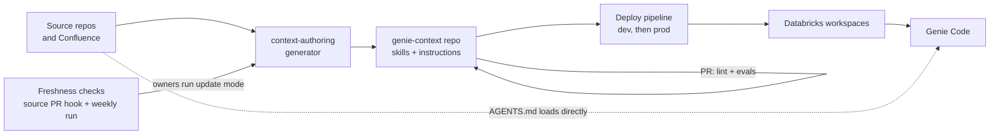

# Skill authoring framework for Databricks Genie Code

A framework for giving **Databricks Genie Code** the organisation-specific context it needs — conventions, guardrails and repeatable tasks — at the lowest token cost, kept current automatically, with many teams contributing under one standard.

In this README, `genie-context` is the name of the central repo you create from this framework in your organisation.

It manages four kinds of context, generates drafts from code and documentation, tests that every skill actually changes the agent's answers, deploys to one or more workspaces from a single pipeline, and flags skills when the code or pages they were written from change.

```
genie-context
├── a standard           docs/STANDARD.md + standard.yaml (limits, prefixes, teams)
├── a generator          .claude/skills/context-authoring/  (Claude Code or Genie Code)
├── a CLI                skillkit: lint, eval, build, deploy, freshness, ...
├── pipelines            Azure DevOps: PR validation, deploy, weekly maintenance, source-repo hook
└── the content          skills/, context/workspace-instructions.md
```

**Contents**

1. [Why this exists](#1-why-this-exists)
2. [The four context layers](#2-the-four-context-layers)
3. [How it works](#3-how-it-works)
4. [Repository layout](#4-repository-layout)
5. [Quick start](#5-quick-start)
6. [One-time setup](#6-one-time-setup)
7. [Authoring skills](#7-authoring-skills)
8. [Skill format](#8-skill-format)
9. [Evals](#9-evals)
10. [Multi-team repositories](#10-multi-team-repositories)
11. [Skills that use other skills](#11-skills-that-use-other-skills)
12. [Deployment](#12-deployment)
13. [Keeping context current](#13-keeping-context-current)
14. [skillkit reference](#14-skillkit-reference)
15. [Configuration: standard.yaml](#15-configuration-standardyaml)
16. [Pipelines](#16-pipelines)
17. [Standards this follows](#17-standards-this-follows)
18. [Development](#18-development)
19. [Known limitations](#19-known-limitations)

---

## 1. Why this exists

Coding agents produce generic answers on an internal platform: they invent helper names, hardcode environment values, write a `MERGE` by hand where the platform has a template, and don't know the release process. Adding context fixes that, but done naively it creates new problems:

| Naive approach | Problem | What this framework does instead |
| --- | --- | --- |
| Put everything in skills, with a router skill that points to the others | Every task loads the router plus several skill bodies; routing logic is duplicated and drifts | Repo conventions go in `AGENTS.md` (loaded automatically); skills are selected by their descriptions; no router |
| Tell skills to read the repo at runtime | Every use pays for reading files whose content could have been distilled once | Static knowledge is distilled at authoring time; runtime lookups only for live state |
| Generate the whole skill family once | Code and docs change daily; regenerating overwrites manual fixes | Per-skill sources, an update mode for one skill, and freshness checks |
| One convention per repo | Several teams share a repo and work differently | A platform contract plus team overrides and skill variants |
| Trust that a skill helps | Many skills restate what the model already knows | Every skill is evaluated with and without itself; only skills that change the outcome merge |

## 2. The four context layers

Each piece of knowledge goes in the **cheapest layer that works**:

| Layer | Loaded by Genie Code | Holds | Lives in | Owner |
| --- | --- | --- | --- | --- |
| Workspace instructions | Every response, every user | Environments, hard constraints, PII/GDPR guardrails | `context/workspace-instructions.md` → `/Workspace/.assistant_workspace_instructions.md` | Platform team |
| `AGENTS.md` | When a file under that folder is open (nested files stack) | A repo's or team folder's conventions and vocabulary — only what the agent cannot infer from the code | The source repo, next to the code | Repo / folder owner |
| Skill | Name + description always; body only when the task matches | A repeatable task with organisation-specific steps | `skills/<name>/` → `/Workspace/.assistant/skills/<name>/` | Team registered for the prefix |
| Unity Catalog comments and tags | When the agent inspects a table | Meaning, grain, source system, PII of data | Unity Catalog | Data owner |

A skill is justified only when it describes a **task** people repeat, the agent gets it wrong **without** it (proven by the baseline eval), and the content is **specific** to the organisation.

`AGENTS.md` loads only inside the repo. Skills for tasks that usually start elsewhere (monitoring questions, data lookups in the SQL editor) carry the vocabulary they need themselves.

## 3. How it works



The generator's phases:

| Phase | What happens |
| --- | --- |
| Analyze | Inventory of tasks, helpers, config, vocabulary and guardrails, with a source for every fact; code wins over docs |
| Classify | Every item goes to one layer (instructions, `AGENTS.md`, skill, UC comment, script) or is dropped as public knowledge |
| Decide conflicts | Docs vs code, team vs team, new vs existing context: listed in `conflicts.md`; generation stops until people decide each one |
| Map | One skill per task, named `<prefix>-<verb>-<object>`; team differences become variants; existing skills are reused by name |
| Generate | Draft skills in the standard format; proposals for workspace instructions, `AGENTS.md` candidate lines and UC comments |
| Validate | Lint, a "verify against the code" pass, evals with and without each skill; skills with no effect are dropped |
| Maintain | Per-skill sources and review dates; update mode for one skill; freshness checks |

## 4. Repository layout

```
genie-context/
├── standard.yaml                       limits, prefixes, teams, workspace paths, eval endpoints
├── docs/STANDARD.md                    the standard every skill, AGENTS.md and instruction follows
├── context/
│   └── workspace-instructions.md       deployed to /Workspace/.assistant_workspace_instructions.md
├── skills/<prefix>-<verb>-<object>/    one folder per skill (active ones are deployed)
│   ├── SKILL.md                        instructions (deployed)
│   ├── references/ assets/ scripts/    detail, templates, code (deployed)
│   ├── skill.yaml                      registry record: owner, status, sources, uses (repo only)
│   └── evals/evals.json                test cases (repo only)
├── templates/                          skill scaffold; AGENTS.md templates for repos and team folders
├── evals/decoys.yaml                   stand-ins for built-in Databricks skills in routing tests
├── .claude/skills/context-authoring/   the generator skill and its references
├── skillkit/                           the CLI (Python)
├── notebooks/run_skillkit.py           runs skillkit inside a Databricks workspace
├── pipelines/                          Azure DevOps pipelines and templates
├── examples/data-platform/                    example root AGENTS.md and its eval cases
└── tests/                              unit tests (pytest)
```

## 5. Quick start

Requirements: Python 3.10+; for `eval` and `deploy`, Databricks authentication.

```bash
pip install -e ".[dev]"
pytest -q                                   # unit tests
skillkit lint                               # all skills, catalog budget, workspace instructions
skillkit catalog                            # skills, owners, token budget use
skillkit new dp-onboard-source-table       # scaffold a draft skill
skillkit eval dp-create-silver-table --runs 3 --repos-root ~/repos
skillkit build && skillkit deploy --dry-run --profile dev
```

Databricks authentication uses the SDK defaults: a CLI profile (`--profile`), or `DATABRICKS_HOST` plus `ARM_CLIENT_ID`, `ARM_CLIENT_SECRET`, `ARM_TENANT_ID` for a service principal.

**Without a local terminal** (e.g. where Claude Code is not allowed): clone this repo and the source repos as Git folders in your Databricks user folder, and run `notebooks/run_skillkit.py` on serverless compute. Set the widgets (`command`, `skills`, `extra`) and run all.

## 6. One-time setup

Done once by the platform team. Step 7 must happen before the first deploy, because the deploy removes workspace skills that are not in the repo.

1. **Create the repo and adapt it to your organisation.** Everything organisation-specific is an example to replace:
    - `standard.yaml`: `teams`, `prefixes` and reviewer groups; the environment catalog regex in `forbidden_patterns` (the example uses `lakehouse_dev|stg|prd`); eval endpoints.
    - `context/workspace-instructions.md`: your environments and hard rules.
    - `pipelines/*.yml`: the `<project>/data-platform` source repo names (marked `TODO`).
    - `evals/decoys.yaml`: the built-in skills present in your workspace.
    - `skills/dp-create-silver-table` and `examples/data-platform/`: a fictional example skill and `AGENTS.md`; delete or replace them.
2. **Create a service principal**, add it to every target workspace, and grant it `CAN MANAGE` on `/Workspace/.assistant/` and the instructions file, plus `CAN QUERY` on the eval endpoints. Only admins can create items at the workspace root, so an admin creates the `.assistant` folder and an empty instructions file first.
3. **Lock the skills folder**: all users `CAN READ` (Genie Code reads skills as the user); no other write grants.
4. **Create variable groups** `genie-context-dev`, `genie-context-prod` (`DATABRICKS_HOST`, `ARM_*`) and `genie-context-confluence` (`CONFLUENCE_BASE_URL`, `CONFLUENCE_TOKEN`, `CONFLUENCE_EMAIL` for Cloud).
5. **Create environments** `genie-context-dev` and `genie-context-prod`, with an approval check on prod.
6. **Create the pipelines** from `pipelines/*.yml` (replace the `TODO` repo names). On `main`: require PRs, add `pr-validation` as a required build validation, add the reviewers printed by `skillkit reviewers`, and turn on "prohibit the most recent pusher from approving their own changes".
7. **Import what exists**: merge the current workspace instructions into `context/workspace-instructions.md`; export existing workspace skills, then bring each into `skills/`, merge it, move it to `AGENTS.md`, or retire it. Set `DEPLOY_FLAGS=--no-prune` until every legacy skill is decided.
8. **First deploy**: merge to `main` and check the plan step before approving prod.

## 7. Authoring skills

Skills are drafted by the generator, decided on by people, and merged only when the eval shows they help.

**With Claude Code**: open Claude Code in this repo — the generator in `.claude/skills/` is picked up automatically — and ask:

> Use context-authoring in create mode for data-platform, folders Databricks/Bronze and Databricks/Silver, team data-platform, Confluence pages: …

**With Genie Code**: copy `.claude/skills/context-authoring/` to `/Workspace/Users/<you>/.assistant/skills/`, clone this repo and the source repos as Git folders side by side, and give the same prompt in an Agent-mode chat. The generator runs `skillkit` through `notebooks/run_skillkit.py`. Run each phase in a new thread; the generator writes every phase's result to `authoring/runs/<date>-<scope>/` so the next thread picks up from files.

The steps:

1. Branch this repo.
2. Run the generator. It writes `inventory.md` and `classification.md`.
3. **Decide the conflicts.** The generator writes `conflicts.md` and stops. The author, the platform team and any affected team decide each row:

   | Conflict | Who decides |
   | --- | --- |
   | Docs vs code | Owner of that area; the losing side gets fixed |
   | Code vs workspace guardrails | Platform team, with the governance owner for PII and access |
   | Team vs team | Platform team and the team: does it break the contract? If not, it becomes a variant |
   | New vs existing skill or instruction | Owner of the existing content, with the author |

   Decisions: **Variant**, **Align** (one way wins), **Fix code**, **Fix docs**, or **Open** (nothing that depends on it is generated).
4. The generator writes draft skills and proposals, runs lint and evals, drops skills with no effect, and writes `summary.md`.
5. Review every file as the owner; replace `TODO`s; narrow the `sources` globs.
6. Check two prompts in a real Genie Code Agent-mode chat with the skill installed in your user folder.
7. Set `status: active` for skills with an ADDS VALUE verdict.
8. Open the PR; the pipeline posts lint results and the eval report.
9. Send proposals to their owners: a person writes the `AGENTS.md` from the candidate lines; instruction changes go to the platform team; UC comments to data owners.

A hand-written skill starts with `skillkit new <name>` and continues from step 5.

## 8. Skill format

```
skills/dp-create-silver-table/
├── SKILL.md
├── references/forecasting.md
├── assets/silver_notebook.py
├── skill.yaml
└── evals/evals.json
```

**`SKILL.md`** — follows the [Agent Skills specification](https://agentskills.io/specification), with stricter house rules:

```markdown
---
name: dp-create-silver-table
description: >-
  Creates a new Silver table in the data platform from an existing Bronze table: setup DDL,
  the merge notebook on the shared template, and the global table and view. Use when
  the user asks to add or create a silver table or a bronze-to-silver merge.
  Not for changing an existing silver table.
---

## Steps
1. ...

## Verify
- ...
```

| Rule | Value |
| --- | --- |
| Frontmatter | `name`, `description` required; spec fields `license`, `compatibility`, `metadata` allowed; nothing else |
| Name | `<team-prefix>-<verb>-<object>`, lowercase, single hyphens, ≤ 64 characters, equals the folder name |
| Description | 80–600 characters, third person, contains "Use when"; ends with "Not for …" when a neighbour shares vocabulary |
| Body | ≤ 200 lines and ≈ 2,500 tokens; sections `Steps`, `Verify` (required, in order), optional `Gotchas`, `Rules`, `Examples`, `References` |
| Content | Only what differs from default practice, one line of reasoning per rule; one default per decision; no hardcoded environment values; no dates or version notes; no runtime reads of static knowledge |
| References | Linked from `SKILL.md`; no further links; files > 100 lines start with `## Contents` |

**`skill.yaml`** — the registry record, never deployed:

```yaml
owner: data-platform            # team registered for the prefix
status: active                  # draft | active | deprecated
last_reviewed: 2026-11-23
sources:                        # drives freshness checks
  - repo: data-platform
    paths: [Databricks/Setup/Silver/**, Databricks/Common/silver_lib/merge_template*]
  - confluence:
      page_id: "123456"
      title: Create a PR
      version: 14
uses: [dp-tag-pii-columns]     # skills named in the steps
requires: []                    # MCP servers, packages, services
variants:                       # parts owned by another team
  - reference: references/forecasting.md
    owner: forecasting
    applies_when: Notebook under the Forecasting folder
```

In `paths`, `**` crosses folders, `*` matches within one, and a path without wildcards matches itself and everything below it.

At build time, `owner` and the source commit are stamped into the deployed `SKILL.md` under `metadata`.

## 9. Evals

`skillkit eval` decides whether a skill merges. It simulates Genie Code through Databricks model serving endpoints and runs nothing in the workspace.

**Case format** (`evals/evals.json`, the Agent Skills layout plus extensions):

```json
{
  "skill_name": "dp-create-silver-table",
  "evals": [
    {
      "id": "silver-01",
      "type": "trigger",
      "prompt": "Create the silver table and notebook for nordics_bronze.crm_contract_account",
      "agents": ["data-platform/AGENTS.md"],
      "must_include": ["merge_template", "COMMENT\\s+'UQ'"],
      "must_not_include": ["\\blakehouse_(dev|stg|prd)\\b", "(?m)^\\s*MERGE\\s+INTO"],
      "assertions": ["Creates the global_silver twin partitioned by region_key"]
    },
    { "id": "nm-01", "type": "near_miss", "prompt": "Add a column to an existing silver table" }
  ]
}
```

At least two `trigger` cases and one `near_miss`; more are expected for active skills.

**What runs:**

| Test | Model sees | Passes when |
| --- | --- | --- |
| Routing (every case) | All active skill names and descriptions, the skills under test, decoys for built-in skills | Trigger: picks this skill at a rate ≥ 0.5 over `--runs`. Near miss: does not |
| Answer with skill (trigger cases) | Workspace instructions, the case's `AGENTS.md` files, skills in `uses`, the skill | Every `must_include` matches, no `must_not_include` matches, the judge passes every assertion — on a majority of runs |
| Answer without skill | The same minus the skill | Same scoring: the baseline |

The judge is a second model from a different family (set in `standard.yaml`). The report also shows the extra tokens per answer each skill costs.

| Verdict | Meaning | Action |
| --- | --- | --- |
| **ADDS VALUE** | All cases pass, and at least one passes only with the skill | Merge |
| **NO EFFECT** | The model already gets it right | Don't merge; move one useful rule to `AGENTS.md` or drop it |
| **FAILING** | A routing or answer case fails | Inspect with `--inspect <case-id>`; fix the skill, its description or the case |

**Coexistence**: when any skill changes, the PR pipeline reruns routing for **every** active skill, so a new description cannot steal prompts from existing ones. The linter also warns when two descriptions overlap.

**`AGENTS.md` is evaluated too**: `skillkit eval-context --cases examples/data-platform/agents-evals.json --repos-root ~/repos` runs the same prompts with and without the `AGENTS.md` files. Research found generated context files slightly lowered agent success and raised cost by over 20%, while short human-written ones helped — so people write `AGENTS.md`, and it has to show it helps.

## 10. Multi-team repositories

- The platform team defines a short **contract** in the repo's root `AGENTS.md` (technical columns, merge keys, PII tagging, deployment scripts, bundle rules). It applies in every folder.
- Each team adds an `AGENTS.md` in its folder (`templates/AGENTS.team.md`) that states its overrides explicitly.
- A shared task stays **one skill**. When a team does it differently, step 1 names the condition (folder or schema) and links `references/<team>.md`, declared under `variants` with its owner. Two skills for the same task would compete for the same prompts.
- A difference that breaks the contract is fixed in the code, never documented as a variant.
- Ownership is enforced by required reviewers per path; `skillkit reviewers` prints the filters.

## 11. Skills that use other skills

Skills come in two kinds:

- **Building blocks** — one focused task (`dp-configure-autoloader`, `dp-prepare-pr`). Only created when people also ask for that task on its own; otherwise the steps stay in the workflow, because many narrow skills loaded for one task add overhead and conflicting instructions.
- **Workflows** — an end-to-end journey that names building blocks at the step where they're needed ("Ingest to Bronze: follow the `dp-configure-autoloader` skill with …") and holds only the glue.

Rules (checked by the linter): every skill named in the body is listed in `uses` and vice versa; used skills exist and are active; no cycles; depth ≤ 2; platform skills never use team skills. Evals run a workflow with its building blocks present, so the baseline measures the workflow's own value.

## 12. Deployment

A merge to `main` touching `skills/`, `context/` or `standard.yaml` runs `pipelines/deploy.yml`:

1. `skillkit build` lints (refusing on errors), copies active skills without repo-only files, stamps owner and commit into each `SKILL.md`, and writes `manifest.json` with a SHA-256 per file.
2. The dev stage prints the plan (`create`, `replace`, `delete`, `upload`) and applies it.
3. The prod stage waits for approval, prints the plan and applies it.

`skillkit deploy` verifies the checksums before uploading and writes the manifest to `/Workspace/.assistant/genie-context-manifest.json`, so what runs in a workspace can be traced to a commit. The deploy is authoritative: workspace skills not active in the repo are removed unless `--no-prune`.

**Rollback**: revert the PR, or set `status: deprecated`; the next deploy removes the skill.

## 13. Keeping context current

| Trigger | Detected by | Action |
| --- | --- | --- |
| Code a skill was written from changes | Source repo PR hook (`pipelines/templates/source-repo-freshness.yml`) comments with the affected skills and owners | Owner runs update mode with the changed paths |
| A source Confluence page changes | Weekly run (`skillkit confluence-check`) | Update mode, then `confluence-check <name> --write` |
| Review period passes (120 days) | Weekly run (`skillkit stale`) | Re-run evals; `skillkit reviewed <name>`, update or deprecate |
| A wrong answer is reported | Users | Add the prompt as a failing eval case first, then fix |
| An eval regresses | Weekly regression run | Inspect the answer; fix the skill or the case |

**Update mode** edits only the lines that are no longer true, so earlier manual fixes survive:

> Use context-authoring in update mode for dp-create-silver-table; data-platform changed Databricks/Common/silver_lib/merge_template.py in commits abc123..def456.

## 14. skillkit reference

| Command | What it does |
| --- | --- |
| `lint [skills]` | Checks skills; with no names also catalog budget, overlap, dependencies and workspace instructions |
| `lint-agents <files>` | Checks `AGENTS.md` files (size, no emails or tokens) |
| `catalog` | Skills, status, owner, description tokens, budget use |
| `new <name>` | Scaffolds a draft skill; owner from the prefix |
| `eval [skills]` | Routing and answer tests with baseline. `--mode all\|routing\|answer`, `--runs N`, `--threshold`, `--no-baseline`, `--require-value`, `--case-filter`, `--inspect ID`, `--repos-root`, `--model`, `--judge`, `--out`, `--json` |
| `eval-context --cases F --repos-root D` | Evaluates `AGENTS.md` files with and without them |
| `build [--out]` | Lints, then bundles active skills and instructions with checksums |
| `deploy [--build] [--dry-run] [--no-prune] [--profile]` | Verifies checksums, uploads skills, instructions and manifest |
| `freshness --repo R --changed … \| --changed-file F` | Skills whose sources match changed files (`--format text\|markdown\|json`) |
| `changed --base B` | Skills touched since `B` (all, if shared context changed) |
| `stale` | Active skills past the review period |
| `reviewed <skills>` | Sets `last_reviewed` to today |
| `confluence-check [skills] [--write]` | Compares recorded Confluence versions with the live pages |
| `reviewers` | Azure DevOps required-reviewer path filters and separation-of-duties settings |

**Lint codes**

| Code | Checks |
| --- | --- |
| SK001–SK006 | `SKILL.md` exists; frontmatter fields; name pattern, folder match, registered prefix; description length and "Use when" |
| SK007–SK009 | Body size; required and allowed sections |
| SK010–SK012 | Links resolve; reference files don't link further; long references start with `## Contents` |
| SK013 | No catalog names, hosts, emails, GUIDs, tokens or dated notes in deployed files |
| SK014–SK016 | `skill.yaml` fields; `evals/evals.json` minimums; variants |
| SK017–SK019 | No `TODO` in active skills; no stray files; deprecated notice |
| SK020 | Security review warnings: scripts, network calls, external URLs, paths outside the skill |
| SK021 | `uses` matches the skills named in the body; dependencies exist and are active |
| CT001–CT004 | Catalog budget; duplicate names; description overlap; dependency cycles, depth and direction |
| WI001–WI003 | Workspace instructions size, token budget, no emails or tokens |
| AG001–AG002 | `AGENTS.md` size, no emails or tokens |

## 15. Configuration: standard.yaml

| Key | Purpose |
| --- | --- |
| `platform_team`, `teams`, `prefixes` | Who owns which skill prefix; reviewer groups |
| `limits` | Description, body, catalog, instruction and `AGENTS.md` budgets |
| `review_period_days` | When an active skill counts as stale |
| `sections` | Required and optional `SKILL.md` sections |
| `catalog` | Overlap warning threshold; maximum dependency depth |
| `forbidden_patterns`, `forbidden_patterns_context` | Regexes rejected in skills / in instructions and `AGENTS.md` |
| `workspace` | Skills path, instructions path, manifest path |
| `eval` | Model endpoint, judge endpoint, max tokens, trigger threshold |

## 16. Pipelines

| File | Trigger | Does |
| --- | --- | --- |
| `pipelines/pr-validation.yml` | Branch policy build validation | Unit tests, lint, evals with baseline for changed skills (3 runs), routing for all skills, report posted on the PR. `EVAL_GATE=advisory` reports failures as warnings during a pilot; `blocking` fails the PR |
| `pipelines/deploy.yml` | Merge to `main` | Build, deploy to dev, then prod after approval |
| `pipelines/maintenance.yml` | Mondays 05:00 UTC | Stale reviews, changed Confluence pages, regression eval, budget use; fails if anything needs an owner |
| `pipelines/templates/source-repo-freshness.yml` | Included in a source repo's PR build | Comments with the skills a change may affect |

The pipelines target Azure DevOps (Azure Repos ignores `pr:` triggers in YAML; use branch policies). The build service needs "Contribute to pull requests" to post comments.

## 17. Standards this follows

| Standard / source | How it is applied |
| --- | --- |
| [Agent Skills specification](https://agentskills.io/specification) | Skill format, progressive disclosure, optional frontmatter fields, `evals/` layout, with/without-skill evaluation, trigger-rate testing |
| [AGENTS.md](https://agents.md/) | Repo and team-folder conventions; nearest file convention, with explicit overrides |
| [Databricks Genie Code skills](https://docs.databricks.com/aws/en/genie-code/skills) and [instructions](https://docs.databricks.com/aws/en/genie-code/instructions) | Workspace skills folder, instruction file and its 20,000-character limit, one task per skill |
| [Anthropic: skills for enterprise](https://platform.claude.com/docs/en/agents-and-tools/agent-skills/enterprise) | Git as source of truth, separation of duties, security review, eval gates incl. coexistence, versioning and rollback |
| [GitHub Copilot](https://docs.github.com/en/copilot/concepts/prompting-and-context/custom-instructions), [OpenAI Codex](https://developers.openai.com/codex/guides/agents-md) | Layered and path-scoped instructions; avoiding conflicting instructions |
| [Evaluating AGENTS.md (ETH Zurich)](https://arxiv.org/html/2602.11988v1) | `AGENTS.md` written by people, limited to non-inferable facts, and evaluated |

Where this framework is stricter than the specification (description ≤ 600 characters, body ≤ 200 lines, required `Steps`/`Verify`, team prefixes), it is because every description is paid in every session of a shared workspace. Each limit is a value in `standard.yaml`.

## 18. Development

```bash
pip install -e ".[dev]"
pytest -q          # 39 tests: lint rules, freshness, build and checksums, deploy (mocked), evals (fake LLM)
```

The code is plain Python with `pyyaml`, `requests` and (optionally) `databricks-sdk`. `deploy` and `eval` import the SDK lazily, so linting and building need no Databricks access.

To add a lint rule: add the check in `skillkit/lint.py` with a new code, document it in `docs/STANDARD.md` and the table above, and add a test in `tests/test_lint.py`.

## 19. Known limitations

- **Undocumented Genie Code behaviour.** Precedence between nested `AGENTS.md` files and workspace instructions, which Genie Code modes read `AGENTS.md`, whether a skill named in another skill's steps is loaded, and catalog limits are not documented. Test them before relying on them.
- **Evals are a simulation.** They use model serving endpoints, not the Genie Code agent itself, so real triggering may differ. Each new skill also gets a manual check in a real Agent-mode chat.
- **Deploy and pipelines are tested with mocks only.** Run the first deploy against a dev workspace with `--dry-run`.
- **Workspace skills are not scoped.** Every workspace user sees every workspace skill; team-only skill sets need per-user skill folders.
- **The example skill** (`skills/dp-create-silver-table`) is an illustrative draft with `TODO` markers; regenerate it with the generator before activating.
