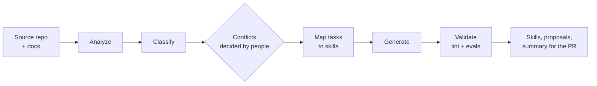

# Skill authoring framework for Databricks Genie Code

**`context-authoring`** is a meta-skill: a skill that teaches an AI agent (Claude Code, Genie Code, or any agent that supports [Agent Skills](https://agentskills.io/specification)) to turn a repo your teams work in on Databricks (data engineering, ML, analytics, apps) and its documentation into the context Databricks Genie Code needs:

- **task-shaped workspace skills**, each with eval cases;
- **`AGENTS.md` candidate lines** for the repo and team folders;
- **workspace-instruction** and **Unity Catalog comment** proposals.

It works on any repo and any docs, however a team works: it reads what is there, asks people to decide where sources disagree, and produces context in an open format (Agent Skills, `AGENTS.md`). It is built for repos that people work in every day, that several teams share, and that change constantly. It extends the approach of [framework-skill-authoring](https://github.com/grusin-db/framework-skill-authoring), which documents a packaged library for agents that only have the installed package.

**Contents**

1. [What it does](#1-what-it-does)
2. [Key terms](#2-key-terms)
3. [When to use it](#3-when-to-use-it)
4. [Install](#4-install)
5. [Use it](#5-use-it)
6. [The phases](#6-the-phases)
7. [What you get](#7-what-you-get)
8. [Design principles](#8-design-principles)
9. [How it differs from framework-skill-authoring](#9-how-it-differs-from-framework-skill-authoring)
10. [What's in the meta-skill](#10-whats-in-the-meta-skill)
11. [Adopting it in your organisation](#11-adopting-it-in-your-organisation)
12. [Repository layout](#12-repository-layout)
13. [Standards it follows](#13-standards-it-follows)
14. [Known limitations](#14-known-limitations)

---

## 1. What it does



| Input | Output |
| --- | --- |
| A source repo checkout and the folders in scope | Draft skills in `skills/<prefix>-<verb>-<object>/`, each with `SKILL.md`, `skill.yaml` (owner, sources) and `evals/evals.json` |
| Docs: Confluence or another wiki via a connector, Markdown in the repo, or exported pages | `AGENTS.md` candidate lines with evidence, for people to write the file from |
| The owning team and its skill prefix | Workspace-instruction changes and Unity Catalog comments as proposals for their owners |
| Existing skills, instructions and `AGENTS.md` files | A conflict list for people to decide, and a summary for the pull request |

It has two modes: **create** (a repo, team or domain gets its context for the first time) and **update** (one skill's sources changed, or it gave a wrong answer).

## 2. Key terms

| Term | Meaning |
| --- | --- |
| Genie Code | The Databricks coding agent that reads the context this framework produces |
| Context | Everything Genie Code reads besides the user's prompt: workspace instructions, `AGENTS.md` files, skills, Unity Catalog comments |
| Skill | A folder with a `SKILL.md` that teaches the agent one task; Genie Code loads its description always and its body only when the task matches ([Agent Skills](https://agentskills.io/specification)) |
| Meta-skill | A skill that writes skills; here `context-authoring` |
| Source repo | The repo the context describes (your code) |
| Context repo | The repo where your organisation keeps its skills and workspace instructions; called `genie-context` in these docs |
| Run folder | Where one meta-skill run writes its working files: `authoring/runs/<date>-<scope>/` |
| Platform team | The team that owns the context repo and the workspace instructions; in a small organisation it may be the only team |
| Owning team | The team registered for a skill's name prefix; it maintains and approves that skill |
| Contract | The few rules every team in a shared repo follows (written in the repo's root `AGENTS.md`); inside it, teams work their own way |
| Variant | One team's way of doing a shared task, kept as a reference file inside the shared skill |
| Eval verdict | ADDS VALUE, NO EFFECT or FAILING: whether a skill changes Genie Code's answers for the better |

## 3. When to use it

| Situation | Use |
| --- | --- |
| A repo people work in, with its own conventions and process: notebooks, pipelines, jobs, bundles, ML code, dashboards | **context-authoring** |
| Several teams share one repo with different conventions | **context-authoring** (contract + team variants) |
| Code and docs change daily and skills must keep up | **context-authoring** (update mode, per-skill sources) |
| A packaged library (wheel, jar) used by people who don't have its source | [framework-skill-authoring](https://github.com/grusin-db/framework-skill-authoring) |

## 4. Install

The meta-skill is the folder [`context-authoring/`](context-authoring/). Copy it into your agent's skills folder:

| Agent | Where to copy `context-authoring/` |
| --- | --- |
| Claude Code, for one project | `<project>/.claude/skills/context-authoring/` |
| Claude Code, for all your projects | `~/.claude/skills/context-authoring/` |
| Databricks Genie Code (personal) | `/Workspace/Users/<you>/.assistant/skills/context-authoring/` |
| Other Agent Skills–compatible agents | The agent's skills folder |

Install it as a personal skill, not a workspace skill: it is an authoring tool for the people who write context, not for every Genie Code user.

**Optional, recommended:** install the `skillkit` CLI from this repo (`pip install -e .`). The meta-skill then lints its output and runs evals with and without each skill. Without it, the meta-skill checks the output contract by hand and says in its summary that no evals ran. In Genie Code, where there is no terminal, clone this repo as a Git folder and run [`notebooks/run_skillkit.py`](notebooks/run_skillkit.py) instead.

## 5. Use it

### Create mode

Open the agent where it can read the source repo, ideally inside your context repo (see [Adopting it](#11-adopting-it-in-your-organisation)), and ask:

> Use context-authoring in create mode for the data-platform repo, folders Databricks/Bronze and Databricks/Silver, team data-platform, prefix dp. Docs: the exported pages in ./docs-export/.

Replace the repo, folders, team, prefix and docs with your own. All names in this README are from a fictional example.

The meta-skill works in phases and writes every result to a run folder, `authoring/runs/<date>-<scope>/`. In Genie Code, start **each phase in a new thread** and point it at the run folder, so long chats don't degrade the output:

| Thread | Ask |
| --- | --- |
| 1 | "…create mode… Do steps 1–4 only: inventory and classification." |
| 2 | "Continue the run in `authoring/runs/<…>`: step 5, conflicts. Stop and list the decisions I need to make." |
| 3 | "Conflicts are decided. Steps 6–7: map and generate." |
| 4 | "Step 8–9: validate, then write the summary." |

### Deciding conflicts

At step 5 the meta-skill lists every place where sources disagree and **stops**. It never picks a side: a guess is wrong half the time, and writing both sides gives the agent two opposite rules.

| Conflict | Example | Who decides |
| --- | --- | --- |
| Docs vs code | The wiki says a field is informational; the code uses it as a filter | Owner of that area; the losing side gets fixed |
| Code vs workspace guardrails | Code reads tag `pii`; the guardrails say `pii_level` | Platform team, with the governance owner for PII and access |
| Team vs team | Two teams build Silver tables differently | Platform team and the team: does it break the shared contract? If not, it becomes a variant |
| New vs existing context | A new skill contradicts a deployed one | Owner of the existing content, with the author |

Each row gets a decision: **Variant**, **Align** (one way wins), **Fix code**, **Fix docs**, or **Open** (nothing that depends on it is generated).

### Update mode

> Use context-authoring in update mode for dp-create-silver-table; data-platform changed Databricks/Common/silver_lib/merge_template.py in commits abc123..def456.

It reads the skill, its recorded sources and only the diff, then edits the fewest lines that make the skill true again, so earlier manual fixes survive. A reported wrong answer first becomes a failing eval case.

## 6. The phases

| # | Phase | What happens | Writes |
| --- | --- | --- | --- |
| 1 | Scope | Source repo, folders, team and prefix, docs | Run folder |
| 2 | Load what exists | Existing skills, instructions, `AGENTS.md` files | — |
| 3 | Analyze | Tasks people repeat, helpers and signatures, vocabularies (term, values, default, consequence), config, guardrails, folders and owners, with a source for every fact; code wins over docs | `inventory.md` |
| 4 | Classify | Each item to exactly one layer, or dropped as public knowledge | `classification.md` |
| 5 | Find conflicts | Team vs team, docs vs code, new vs existing; **stops for decisions** | `conflicts.md` |
| 6 | Map | One skill per task; team differences as variants; reuse existing skills by name; catalog budget | — |
| 7 | Generate | Draft skills; proposals for other owners | `skills/…`, `agents-md-candidates.md`, `workspace-instructions.diff.md`, `uc-comments.sql` |
| 8 | Validate | Lint; check every name against the code; evals with and without each skill; drop skills with no effect | Eval report |
| 9 | Hand over | Summary for the pull request | `summary.md` |

## 7. What you get

```
authoring/runs/2026-11-24-silver/
├── inventory.md                  every fact, with its source
├── classification.md             which layer each fact went to, and why
├── conflicts.md                  disagreements and the decisions made
├── agents-md-candidates.md       lines for people to write AGENTS.md from
├── workspace-instructions.diff.md
├── uc-comments.sql
└── summary.md                    paste into the PR

skills/dp-create-silver-table/
├── SKILL.md                      Steps, Verify (+ Gotchas, Rules, Examples, References)
├── references/forecasting.md     a team's variant of the same task
├── assets/silver_notebook.py     template the agent copies
├── skill.yaml                    owner, status, sources, uses
└── evals/evals.json              trigger and near-miss cases
```

See [`skills/dp-create-silver-table/`](skills/dp-create-silver-table/) and [`examples/data-platform/`](examples/data-platform/) for a fictional worked example.

## 8. Design principles

**Each piece of knowledge goes in the cheapest layer that works.**

| Layer | Loaded by Genie Code | Holds |
| --- | --- | --- |
| Workspace instructions | Every response, every user | Environments, hard constraints, PII/GDPR guardrails |
| `AGENTS.md` | When a file in that folder is open | Repo and team conventions the agent cannot infer from the code |
| Skill | Description always; body only when the task matches | A repeatable task with organisation-specific steps |
| Unity Catalog comments | When the agent inspects a table | Meaning, grain, source, PII of data |

**Further principles:**

- **Task-shaped skills, no router.** One skill per task people repeat; Genie Code picks skills from their descriptions, so a router skill only adds a hop and duplicates routing.
- **Distil, don't point.** Skills carry the conventions they need; they never tell the agent to read the repo or wiki at runtime. Runtime lookups are for live state only.
- **People decide conflicts.** The meta-skill lists them and stops.
- **People write `AGENTS.md`.** A study found generated context files slightly lowered agent success and raised cost by over 20%, while short human-written ones helped. The meta-skill proposes candidate lines with evidence.
- **Prove value.** Every skill is evaluated with and without itself; a skill the model doesn't need is dropped.
- **Reuse conventions first.** Material shared by several tasks is usually a convention, so it goes to `AGENTS.md`. A skill names another skill only if that one is a task people ask for on their own; short shared steps stay inline. No skill exists only to be reused.
- **One shared task, one skill.** When teams differ, the skill gets a variant per team instead of competing duplicates.
- **Keep human edits.** Update mode changes only what its sources changed.

## 9. How it differs from framework-skill-authoring

[framework-skill-authoring](https://github.com/grusin-db/framework-skill-authoring) is an excellent method for packaged libraries. This meta-skill keeps its analysis and validation ideas and changes what fits a platform repo.

| | framework-skill-authoring | context-authoring |
| --- | --- | --- |
| Consumer | Has only the installed package | Works inside the repo |
| Output | Router skill + one skill per capability domain + "read the router first" instruction | One skill per task; `AGENTS.md`, instructions and UC comments for the rest; no router |
| Conflicts | Recorded in the skills | Decided by people before generating |
| Teams | One owner, one prefix | Contract, team variants, per-team prefixes |
| Size | Up to about 500 lines per skill | About 200 lines and 2,500 tokens; catalog budget |
| Validation | Checklists and source-blind simulation | Lint plus evals with and without each skill |
| After generation | Regenerate by hand | Per-skill sources, update mode, freshness checks |
| **Kept from it** | | Inventory with sources, vocabularies as term/values/default/consequence, config-not-literals, leakage scan, "verify against the code" pass |

## 10. What's in the meta-skill

```
context-authoring/
├── SKILL.md                                 the workflow (both modes)
├── references/
│   ├── layer-classification.md              which layer a fact belongs in
│   ├── conflict-report.md                   conflict decisions and who makes them
│   ├── output-contract.md                   what a generated skill must look like
│   └── update-mode.md                       updating one skill
└── assets/templates/
    ├── run/                                 inventory, classification, conflicts, AGENTS.md candidates, summary
    ├── skill/                               SKILL.md, skill.yaml, evals/evals.json
    ├── AGENTS.repo.md                       root AGENTS.md template
    └── AGENTS.team.md                       team-folder AGENTS.md template
```

## 11. Adopting it in your organisation

Adopt it in stages; each stage is useful on its own.

| Stage | Who | What | Result |
| --- | --- | --- | --- |
| 1. Try it | One person | Install the meta-skill, run create mode on one folder of one repo, decide the conflicts, check two prompts in Genie Code with the drafts installed as personal skills | A few draft skills, and a list of the conventions and conflicts in that area |
| 2. Set up the context repo | Platform team | Create a repo from this framework; adapt `standard.yaml` (teams, prefixes, forbidden patterns), the workspace instructions and the example content; install `skillkit`; lint and run evals locally; write the source repo's `AGENTS.md` from the candidate lines | Reviewed skills that measurably help, in version control |
| 3. Automate | Platform team | Add the CI pipelines (GitHub Actions or Azure DevOps): PR validation with eval reports, deployment to dev then prod; lock the workspace skills folder so only the pipeline writes it | Every change reviewed and evaluated; one writer per workspace |
| 4. Keep it current and grow | Owning teams | Add the freshness hook to source repos and the weekly maintenance run; onboard more teams with their prefix, reviewers and team `AGENTS.md` | Skills that follow the code; more teams under one standard |

Stages 2–4 use the tooling in this repo:

- **A standard** ([`docs/STANDARD.md`](docs/STANDARD.md), [`standard.yaml`](standard.yaml)): limits, team prefixes, sections, forbidden patterns.
- **The `skillkit` CLI**: deterministic lint, evals with baseline and repeated runs, build with checksums, deploy to workspaces, freshness checks against code and docs.
- **CI pipelines** for GitHub Actions and Azure DevOps: PR validation, deployment, weekly maintenance, and a hook that tells source-repo PRs which skills they affect.

Setup, operation and reference: **[docs/operating.md](docs/operating.md)**.

## 12. Repository layout

```
skill-authoring-framework/
├── context-authoring/          the meta-skill: install this
├── docs/
│   ├── STANDARD.md             the standard generated context follows
│   └── operating.md            running it at scale: setup, CLI, evals, deploy, updates
├── standard.yaml               configurable limits, teams, prefixes (example values)
├── context/                    example workspace instructions
├── skills/                     example generated skill (fictional)
├── examples/data-platform/     example AGENTS.md and its eval cases (fictional)
├── skillkit/                   the CLI (Python)
├── notebooks/run_skillkit.py   the CLI inside a Databricks workspace
├── pipelines/
│   ├── github-actions/         workflows to copy into your context repo and source repos
│   └── azure-devops/           the same for Azure DevOps
├── evals/decoys.yaml           stand-ins for built-in skills in routing tests
├── tests/                      unit tests
└── .github/workflows/ci.yml    CI for this repo
```

## 13. Standards it follows

| Source | Applied to |
| --- | --- |
| [Agent Skills specification](https://agentskills.io/specification) and [evaluation guide](https://agentskills.io/skill-creation/evaluating-skills) | Skill format, progressive disclosure, `evals/` layout, with/without-skill evals, trigger-rate testing |
| [AGENTS.md](https://agents.md/) | Repo and team-folder conventions |
| [Databricks Genie Code skills](https://docs.databricks.com/aws/en/genie-code/skills) and [instructions](https://docs.databricks.com/aws/en/genie-code/instructions) | Skill and instruction locations, one task per skill |
| [Anthropic: skills for enterprise](https://platform.claude.com/docs/en/agents-and-tools/agent-skills/enterprise) | Review, separation of duties, coexistence testing, lifecycle |
| [Evaluating AGENTS.md (ETH Zurich)](https://arxiv.org/html/2602.11988v1) | Human-written, minimal, evaluated `AGENTS.md` |
| [framework-skill-authoring](https://github.com/grusin-db/framework-skill-authoring) | Analysis method, vocabularies, validation ideas |

## 14. Known limitations

- **Undocumented Genie Code behaviour.** Precedence between nested `AGENTS.md` files and workspace instructions, which Genie Code modes read `AGENTS.md`, and whether a skill named in another skill's steps gets loaded are not documented. Test them before relying on them.
- **Evals are a simulation** through model serving endpoints, not the Genie Code agent itself. Check each new skill with two prompts in a real Agent-mode chat.
- **Deploy and the CI pipelines are tested with mocks only**; the GitHub Actions and Azure DevOps workflows have not run against a real workspace yet. Start in a dev workspace with `--dry-run`.
- **The example skill is fictional** and contains `TODO` markers.
