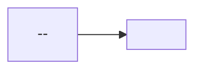

# Skill map: <scope> (planned)

Written at step 6, before any skill exists, so the reviewer sees the planned family: which tasks become skills, which skill uses which, which team gets a variant. At step 8, `catalog --map --out <run folder>/skill-map.md` replaces this file with the map generated from the skills actually written, with eval verdicts.

| Skill | Task (from inventory.md) | Owner | Uses | Used by | Team variants | New or existing |
| --- | --- | --- | --- | --- | --- | --- |
| `<prefix>-<verb>-<object>` | <task> | <team> | `<skill>` | `<skill>` | <team> | new / extends `<skill>` |

Why each skill exists (a task people ask for on its own), and what was not made a skill (moved to `AGENTS.md` candidates, kept inline, or left in `backlog.md`):

- <skill>: <one line>
