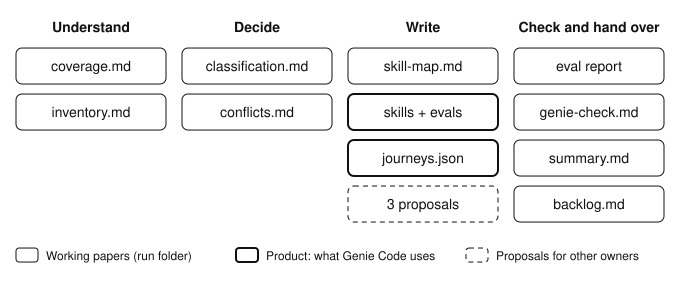

# How it works

## The parts

The **meta-skill** is the framework: a `SKILL.md` with the steps and reference files for the detail, which Genie Code follows. Two kinds of help come from outside it:

- **People** review what the meta-skill found and decide where sources disagree. The agent never guesses a side.
- **Scripts** do the checks an agent can't do reliably on its own work: mechanical rules (lint), whether every name it mentions exists (check-names), and whether each skill actually improves answers, judged by a separate model with and without the skill (eval).

**Operations** (`ops/`: CI, deployment, freshness) are about keeping skills current once a team relies on them. None of it is needed to create good skills.

## The four stages

| Stage | What it does | Where quality comes from |
| --- | --- | --- |
| **Understand** (steps 1–3) | Lists every folder in scope and how closely it was read, then finds the tasks people repeat, with their steps, the helpers they use and the values that matter | Skills follow real tasks, not technology areas; every fact has a source; conventions come only from production code |
| **Decide** (steps 4–5) | Puts each fact in one place (skill, `AGENTS.md`, workspace instructions, table comment, or nowhere) and lists conflicts between teams or between docs and code, with a suggested decision. Then stops | The same rule isn't repeated in ten skills; people settle disagreements |
| **Write** (steps 6–7) | One skill per task, written to the writing rules; eval cases per skill; journeys for tasks that chain skills; proposals for other owners | Real names copied from the code, a default per decision, a guard at the risky step, templates per the assets rule |
| **Check** (steps 8–9) | Lint, name check, evals with and without each skill, a checklist for a real Genie Code chat, a summary and a backlog | A skill that doesn't help is deleted |

## The files a run produces

**The product** is the only part Genie Code uses when helping people.

| File | What's in it |
| --- | --- |
| `skills/<name>/` | `SKILL.md` (the steps), optional `references/` and `assets/`, `skill.yaml` (owner, sources, the skills it uses), `evals/evals.json` (eval cases). `skill.yaml` and `evals/` are never deployed. |
| `evals/journeys.json` | Eval cases for tasks that chain several skills |

**Proposals.** The meta-skill doesn't apply these; it hands each to whoever owns that layer.

| File | For | Contents |
| --- | --- | --- |
| `agents-md-candidates.md` | Repo owners | Conventions every task in a folder needs; people write `AGENTS.md` from them |
| `workspace-instructions.diff.md` | Platform team | Rules that must hold in every Genie Code response |
| `uc-comments.sql` | Data owners | Table and column descriptions |

**Working papers**, in `authoring/runs/<date>-<scope>/`. Genie Code never reads them when helping people. They let you review the work, let a new chat thread pick up where the last stopped, and give the next run a starting point.

| File | What's in it | Why it matters |
| --- | --- | --- |
| `coverage.md` | Every folder: file count, kind (production, shared library, team-owned, tooling, ad hoc, archive), how closely it was read; every doc page read and whether it was useful | A partial run shows as partial; skills never copy from ad hoc scripts |
| `inventory.md` | The facts: tasks with sub-steps, helpers, templates, values, guardrails, each with a source | Skills are written from this, not from memory |
| `classification.md` | Where each fact goes | One place per fact |
| `conflicts.md` | Disagreements, a suggested decision, and the decision people made | The agent never guesses a side |
| Eval report | Per skill: ADDS VALUE, NO EFFECT, FAILING or INCONCLUSIVE | Proof that each skill helps |
| `genie-check.md` | Prompts to paste into a real Genie Code chat and what to look for | The one check the simulation can't do |
| `summary.md` | What was made, results, open items, proposals for each owner | What the reviewer reads first |
| `backlog.md` | Tasks found but not generated yet, and why | Where the next run starts |

`inventory.md` and `conflicts.md` decide quality more than anything later, which is why the meta-skill stops after step 5 for review ([review checkpoint](../context-authoring/references/review-checkpoint.md)).

### What they look like

These examples are fictional.

**`inventory.md`**, one task:

| Task | Sub-steps | Asked for on its own? | Source |
| --- | --- | --- | --- |
| Create a Silver table | copy the setup notebook → set the widgets → merge with `merge_table_silver` → tag PII columns | "tag PII": yes; the rest: no | `Setup/Silver/setup.py`, `lib/merge.py` |

"Tag PII" is asked for on its own, so it becomes its own skill, which the Silver skill names at that step. The other steps stay inside the Silver skill.

**`conflicts.md`**, one row:

| Topic | Way A | Way B | Breaks a shared convention? | Suggested | Decision |
| --- | --- | --- | --- | --- | --- |
| Create a Silver table | Platform: `merge_table_silver` | Forecasting team: its own helper | No | Variant: both valid, chosen by team | Filled in by people |

## Create mode and update mode

**Create mode** gives a repo, team or domain its skills for the first time, or extends the set to new folders or teams. It runs all nine steps and starts from what earlier runs left: existing skills, the backlog, and decisions already made.

**Update mode** fixes one skill whose sources changed or that gave a wrong answer. It reads only what changed, edits the fewest lines that make the skill true again, adds a failing eval case first for a wrong answer, and re-runs the skill's evals and journeys. See [update-mode.md](../context-authoring/references/update-mode.md).
