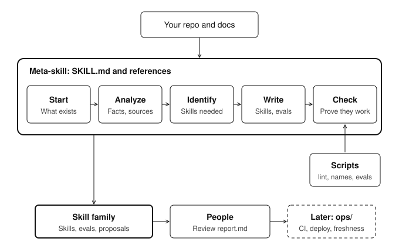

# How it works

## The parts

The **meta-skill** is the framework: a short `SKILL.md` with five steps, and four reference files for the detail, which any agent that supports Agent Skills follows. Two kinds of help come from outside it:

- **Scripts** do what an agent can't do reliably on its own work: start a run from templates (`init`), and check it (`check`): mechanical rules (lint), whether every name exists in the code, and whether each skill improves answers, judged by a separate model with and without the skill.
- **People** review the finished run in `report.md`: the decisions the meta-skill applied, the open conflicts, the proposals for other owners. The meta-skill never decides a contract break; it leaves it open and writes nothing that depends on it.

**Operations** (`ops/`: CI, deployment, freshness) keep skills current once a team relies on them. None of it is needed to create good skills.

## The five steps

| Step | What it does | Where quality comes from |
| --- | --- | --- |
| **Start** | `init` creates the run folder and lists the skills, standing decisions and backlog that earlier runs left | Every run builds on what exists; no second skill for a task that has one |
| **Analyze** | Lists what was read and how closely, then the tasks people repeat and the helpers, vocabularies and facts the consumer would need, each with a source and a layer | Skills follow real tasks; every fact has a source; conventions only from production code |
| **Identify the skills** | Settles each conflict from evidence, or leaves it open; decides which tasks need a skill and plans the family (new, variant, update, unchanged) | People see every decision in one file; a skill changes only when an eval case fails today |
| **Write** | One self-contained skill per task, written to the standard, with eval cases; journeys for skills that chain; proposals for other owners | Everything the task needs written in, real names copied from the code, a default per decision, a guard at the risky step |
| **Check** | `check` runs lint, the name check, evals, the skill map and the agent checklist, and writes them into `report.md` | A skill that doesn't help is deleted |

The meta-skill does not stop between steps. Teams that want to review the facts before any skill is written set `review: before-write` in `standard.yaml`; it then stops after identifying the skills.

## The files a run produces

**The product** is the only part the consumer agent uses. Each skill is self-contained: the agent does its task from the skill without reading the source.

| File | What's in it |
| --- | --- |
| `skills/<name>/` | `SKILL.md`, optional `references/` and `assets/`, `skill.yaml` (owner, sources, the skills it uses) and `evals/evals.json`. `skill.yaml` and `evals/` are never deployed. |
| `evals/journeys.json` | Eval cases for tasks that chain several skills |

**The run folder**, `authoring/runs/<date>-<scope>/`. The consumer agent never reads it. It lets people review the work, lets a new chat thread pick up where the last one stopped, and gives the next run its starting point.

| File | What's in it | Who reads it |
| --- | --- | --- |
| `inventory.md` | Coverage (every folder, how closely it was read, docs read), tasks, helpers and templates, vocabularies, facts, each with a source and a layer | The reviewer spot-checks it; skills are written from it |
| `decisions.md` | Conflicts with the decision and its evidence, the planned skill family, what was not made a skill | The reviewer accepts or changes decisions; the next run keeps the reviewed ones |
| `proposals.md` | `AGENTS.md` candidate lines, always-on instruction changes, catalog comments, forbidden patterns | Each owner applies their part |
| `report.md` | What to review, what was made, the backlog, and the generated checks: lint, names, eval verdicts, skill map, agent checklist | The reviewer first; paste it into the pull request |
| `eval.json` | Full eval results, including every answer | Whoever investigates a failing case |

### What they look like

These examples are fictional.

**`inventory.md`**, one task and one fact:

| Task (verb + object) | Who does it | Sub-steps, in order | Sub-steps asked for on their own | Sources |
| --- | --- | --- | --- | --- |
| Create a Silver table | Data engineers | copy the setup notebook → set the widgets → merge with `merge_table_silver` → tag PII columns | tag PII | `Setup/Silver/setup.py`, `lib/merge.py` |

| Fact | Kind | Needed by | Layer | Source |
| --- | --- | --- | --- | --- |
| `merge_table_silver` replaced `merge_silver`; 14 of 16 notebooks use it | convention | Create a Silver table, Backfill a table | `agents-md:Databricks/` | `grep -rl merge_table_silver Databricks/` |

"Tag PII" is asked for on its own, so it becomes its own skill, which the Silver skill names at that step.

**`decisions.md`**, one conflict:

| # | Topic | Approach A (source) | Approach B (source) | Breaks the contract? | Decision | Why | Skills affected | Reviewed by |
| --- | --- | --- | --- | --- | --- | --- | --- | --- |
| 1 | Create a Silver table | Platform: `merge_table_silver` | Forecasting: its own helper | No | Variant | Same table contract; the team's helper is in all 14 of its notebooks | `dp-create-silver-table` | |

## Create and update

Every run builds on the output folder. A run for a new scope (a repo, team, folder or set of docs) goes through all five steps and, for each task it finds, adds a skill, a variant in the skill that covers the task, or nothing. It changes an existing skill only with an eval case that fails today.

A run about one skill (its sources changed, it gave a wrong answer, a reviewer changed a decision it depends on) follows [update.md](../context-authoring/references/update.md): it reads only what changed, adds a failing eval case first for a wrong answer, edits the fewest lines that make the skill true again, and checks the skill and its journeys.
